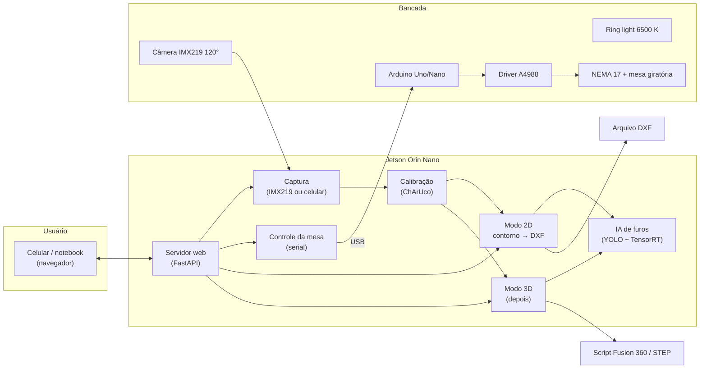
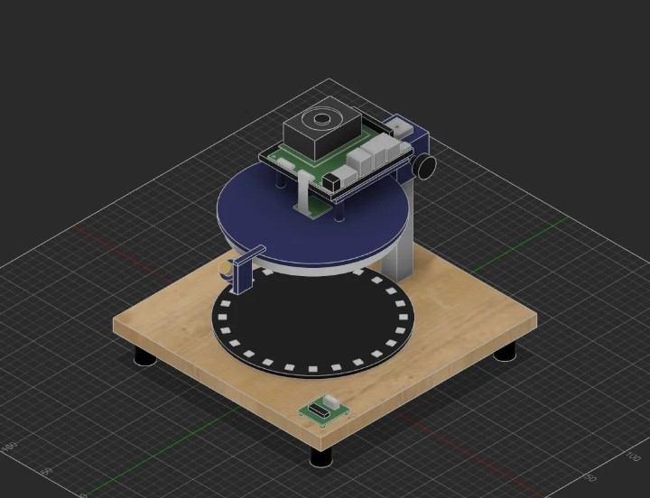
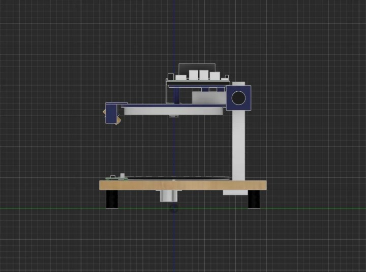

# Etapa 2 – Arquitetura

Status: **em andamento** (iniciado em 14/11/2026)

## Decisões tomadas

| Tema | Decisão |
|---|---|
| Controle do motor | **Arduino Uno/Nano via USB**: o Jetson manda comandos e o Arduino gera os passos (confirmado em 17/11) |
| Motor e driver | **28BYJ-48 + ULN2003** (modelo v5; substitui NEMA 17 + A4988, decidido em 17/11) |
| Interface | **Página web** servida pelo Jetson, operada pelo celular ou notebook |
| Câmera na mesa giratória | **Ângulo fixo de ~30–45°** |
| Luz de fundo (modo 2D) | **Base separada**: caixa com o ring light dentro e tampa translúcida |
| Suporte da câmera | **Haste impressa com duas travas** (90° e ~35°) |
| Prioridade | **Peça plana → DXF** primeiro; peça geral 3D depois |

## Visão geral

## Hardware

### Bancada: duas estações

| Estação | Uso | Montagem |
|---|---|---|
| **Base de luz (2D)** | Peças planas | Caixa impressa com o ring light dentro, tampa de acrílico leitoso ou papel vegetal. Câmera olhando **de cima (90°)** |
| **Mesa giratória (3D + furos)** | Peças gerais | Prato giratório. Ring light em volta da câmera, que olha a **~30–45°** |

**Suporte da câmera (decidido):** uma haste impressa com **duas travas fixas** de ângulo, 90° para a base de luz e ~35° para a mesa giratória. Cada posição é repetível, então a calibração continua valendo.

O ring light muda de lugar entre os modos (dentro da base ou em volta da câmera).

### Lista de componentes

| Item | Status |
|---|---|
| NVIDIA Jetson Orin Nano | ✅ Tem |
| Câmera IMX219 120° (cabo de 22 pinos, liga direto no Orin Nano) | ✅ Tem |
| Ring light 6500 K | ✅ Tem |
| Motor de passo NEMA 17 | ✅ Tem |
| Driver A4988 | ✅ Tem |
| Arduino Uno/Nano + cabo USB | ✅ Tem |
| Impressora 3D + filamento | ✅ Tem |
| Fonte 12 V (≥ 1,5 A) para o motor | ❓ Verificar |
| Capacitor eletrolítico 100 µF (entre VMOT e GND do A4988) | ❓ Verificar (protege o driver, custa centavos) |
| Rolamento 608 (de skate) para o prato | ❓ Verificar |
| Acrílico leitoso ou papel vegetal (tampa da base de luz) | ❓ Verificar |
| Tabuleiro ChArUco | Impresso em papel (custo zero) |

### Mesa giratória

| Parâmetro | Valor |
|---|---|
| Diâmetro do prato | 12–15 cm (peças de até 10 cm) |
| Micropasso no A4988 | 1/16 → 3.200 passos por volta do motor |
| Redução (engrenagem impressa ou correia GT2) | Proposta 1:4 → 12.800 passos por volta do prato (~0,03° por passo) |
| Posição zero (homing) | Pelos **marcadores ArUco no prato**, lidos pela câmera. Dispensa sensor de fim de curso |
| Corrente do motor | Ajustar o Vref do A4988 conforme a corrente do NEMA 17 e o resistor da placa |

### Comunicação Jetson ↔ Arduino (serial USB)

| Comando | Ação | Resposta |
|---|---|---|
| `R <graus>` | Gira o prato | `OK <posição>` |
| `Z` | Define a posição atual como zero | `OK 0` |
| `E 0/1` | Desliga/liga o motor | `OK` |
| `?` | Status | `POS <graus>` |

## Software

| Módulo | Função | Bibliotecas |
|---|---|---|
| `camera` | Captura da IMX219 (CSI) ou do celular (stream IP), com exposição e balanço de branco travados | GStreamer (nvarguscamerasrc), OpenCV |
| `mesa` | Comandos para o Arduino | pyserial |
| `calibracao` | Distorção da lente de 120° e escala em mm | OpenCV (ChArUco) |
| `modo_2d` | Silhueta → contorno → retas/arcos/círculos → DXF | OpenCV, NumPy, ezdxf |
| `furos` | IA acha os furos, a geometria mede, a regra interpreta | Ultralytics YOLO, TensorRT |
| `modo_3d` | Silhuetas da mesa giratória → volume → CAD (depois) | Open3D, CadQuery / API do Fusion |
| `web` | Interface pelo navegador | FastAPI |
| `firmware` | Código do Arduino | Arduino (C++), AccelStepper |

### Fluxo do modo 2D (prioridade)

1. Calibrar a câmera uma vez (tabuleiro ChArUco).
2. Colocar a peça na base de luz e informar a **espessura** (medida com paquímetro na v1).
3. Tirar a foto e corrigir a distorção da lente.
4. Separar a silhueta do fundo (limiar, sem IA).
5. Achar o contorno externo e os furos.
6. Ajustar retas, arcos e círculos.
7. Converter para mm e corrigir a paralaxe pela espessura.
8. Gerar o **DXF** e um relatório com as medidas (ex.: "furo Ø 6,6 mm → passante para M6").

## Projeto CAD da bancada – Scanner v5 (Fusion 360)

Arquivo: [`hardware/ScanParts - Scanner v5.f3d`](../hardware/) (recebido em 17/11/2026).

| Vista isométrica | Vista lateral |
|---|---|
|  |  |

Componentes do modelo:

| Grupo | Componentes no modelo |
|---|---|
| Base | Base MDF, pés de borracha Ø20×30, calços, colunas de apoio, espaçadores |
| Haste | Haste vertical 20×20 (175 mm) com flange sob a base, carro de ajuste com manípulo, braço 20×20 (55 mm) |
| Óptica | Câmera IMX219 com lente, **filtro polarizador CPL**, ring light 6500 K Ø160 (LED Ø170), cabo flat 22 vias |
| **Laser** | **Laser de linha 650 nm Ø12**, com suporte e abraçadeira |
| Mesa giratória | **Prato giratório Ø180** com **24 alvos de referência a cada 15°**, eixo, **motor de passo 28BYJ-48** e **driver ULN2003** |
| Eletrônica | Jetson Orin Nano Dev Kit (placa carrier, módulo SO-DIMM, dissipador, ventoinha, conectores de câmera J20/J21, header de 40 pinos) sobre plataforma própria |

### Diferenças em relação às decisões anteriores (a confirmar)

| Tema | Decidido antes | No modelo v5 |
|---|---|---|
| Motor | NEMA 17 + driver A4988 | **28BYJ-48 + ULN2003** (5 V, redução interna ~1:64, ~2048 passos/volta) → ✅ **adotado** |
| Controle do motor | Arduino Uno/Nano via USB | Arduino não aparece no modelo → ✅ **mantido o Arduino via USB** (incluir no modelo) |
| Luz de fundo (peças planas) | Base separada com o ring light embaixo | Não existe no modelo → ✅ **substituída por fundo preto fosco + ring light + filtro CPL** |
| Laser de linha | Não previsto | **Novo**: permite escaneamento 3D por triangulação a laser com a mesa giratória |
| Filtro CPL | Não previsto | **Novo**: reduz reflexos em peças metálicas |
| Marcadores do prato | ArUco na borda | 24 alvos a cada 15° (mesma função: medir o ângulo real) |

## Pendências da Etapa 2

- [ ] Verificar os itens marcados com ❓
- [ ] Confirmar a versão do JetPack instalada no Jetson
- [x] Diferenças entre o modelo v5 e as decisões anteriores resolvidas (17/11)
- [ ] Incluir o Arduino Uno/Nano no modelo da bancada
- [ ] Fonte 5 V separada para o 28BYJ-48 (~240 mA), sem puxar do pino 5 V do Arduino
- [ ] Desenhar a haste com duas travas, a base de luz e a mesa giratória (croqui)
