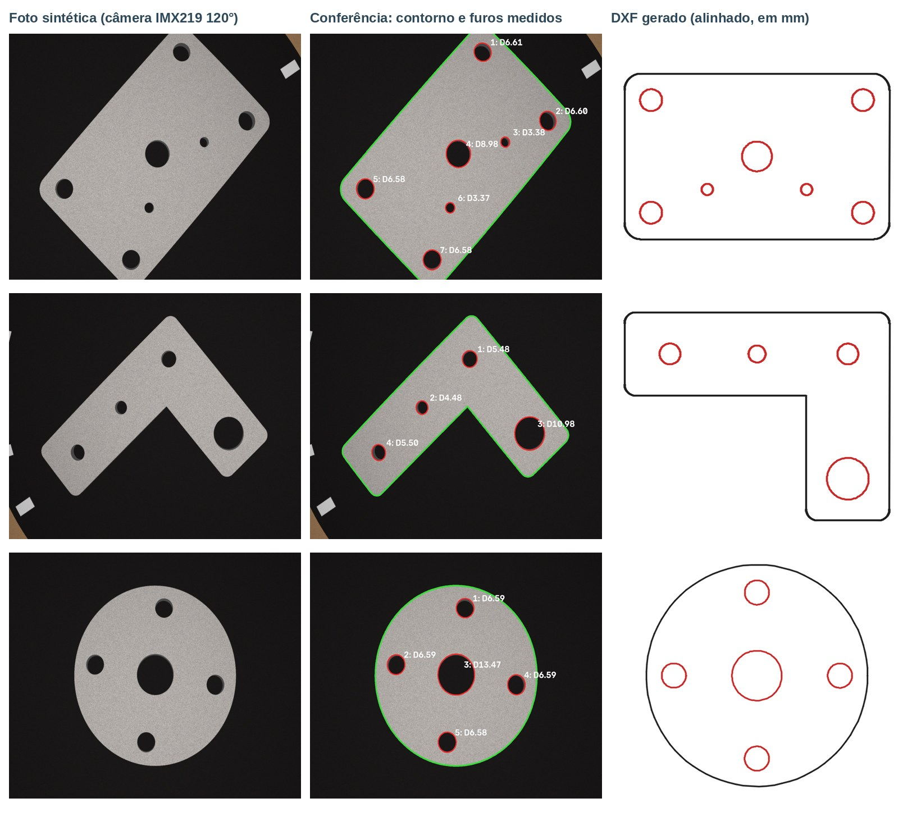
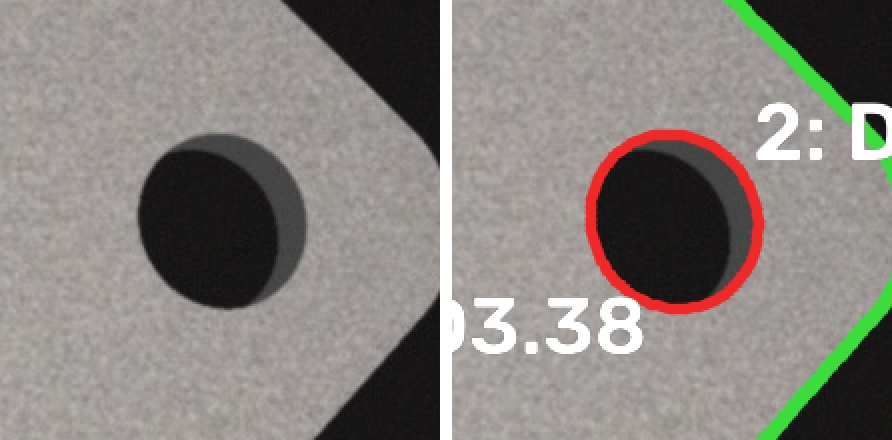
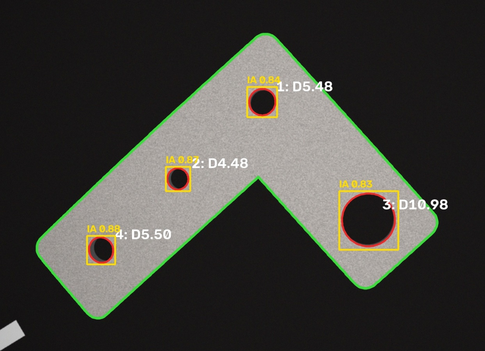

# Software ScanParts: foto → medida → CAD

Status: **primeira versão funcionando e testada com dados sintéticos** (28/11/2026). Ainda falta testar na bancada real.

O pacote `scanparts/` faz o caminho inteiro do modo 2D. Ele recebe uma foto de cima da chapa sobre o prato preto e devolve:

- a medida em mm;
- os furos interpretados pela norma;
- um **DXF**;
- um **script do Fusion** que desenha o sketch e faz a extrusão.



*Figura 1: As três peças de teste. Da esquerda para a direita: a foto sintética da câmera de 120°, a conferência (contorno em verde, furos em vermelho) e o DXF gerado, já alinhado.*

## Onde cada etapa do relatório está no código

| Etapa (relatório, seção 3.3.1) | O que o software faz | Arquivo |
|---|---|---|
| 1. Captura | Foto da IMX219 com exposição e balanço de branco travados (GStreamer) | `captura.py` |
| — Calibração | Tabuleiro ChArUco (Zhang + marcadores ArUco): lente, distorção e posição do prato | `calibracao.py` |
| 2. Localização | O YOLO11n treinado confere os furos que a geometria achou | `ia.py` |
| 3. Medição | Contorno e furos com precisão de subpixel, convertidos em mm com correção de paralaxe pela espessura | `medicao.py`, `geometria.py` |
| 4. Interpretação | Diâmetro → ISO 273 (passante) ou pré-furo de rosca, com alternativas | `normas.py` |
| 5. Saída | DXF (camadas CONTORNO/FUROS/TEXTO) e script Python para o Fusion | `exportar.py` |

Divisão de tarefas: **a IA localiza e a geometria mede.** O YOLO acha onde o furo está, mas uma caixa não dá o diâmetro com ±0,1 mm. Quem mede em mm é a borda de subpixel convertida pela calibração. Se as duas discordarem, o software avisa.

## Como funciona (resumo técnico)

1. **Calibração (uma vez, ou sempre que a câmera mexer)**
   - 12 a 15 fotos do tabuleiro em ângulos variados dão a matriz da câmera e a distorção (modelo de Brown).
   - Uma foto do tabuleiro **deitado no centro do prato** dá a posição exata do prato em relação à câmera.
2. **Segmentação**
   - Limiar de Otsu dentro de um círculo de Ø160 mm no centro do prato: a peça é clara e o prato é preto fosco.
   - A topologia dos contornos separa a borda externa dos furos.
3. **Borda de subpixel**
   - Cada ponto da borda anda pela normal até onde o brilho cruza o meio-termo *local* entre peça e fundo.
   - Isso tirou um viés de −0,06 mm nos furos.
4. **Pixel → mm**
   - Cada ponto vira um raio que sai da câmera, com a distorção removida.
   - O raio é cruzado com o plano do **topo** da peça (z = espessura).
   - Assim a paralaxe da chapa grossa é corrigida e a parede do furo não entra na medida (figura 2).
5. **Furos**
   - Ajuste de círculo pelo método de Kasa seguido de Gauss-Newton.
   - Se o desvio for pequeno, o furo é considerado redondo; senão vira polilinha.
6. **Contorno → CAD**
   - A curvatura separa retas e arcos.
   - Os arcos são ajustados como **concordâncias tangentes** (raio arredondado para 0,5 mm).
   - Retas colineares são unidas e cantos vivos são detectados.
   - Se o desvio passar de 0,4 mm, o contorno cai para polilinha.
7. **Alinhamento**
   - A maior aresta reta fica na horizontal e o canto inferior esquerdo vai para a origem.
   - Peça redonda gira até um furo cair sobre o eixo.
8. **Saída**
   - DXF em mm.
   - Script do Fusion com o parâmetro de usuário `espessura` (editável), cotas de diâmetro e extrusão do perfil.



*Figura 2: Furo perto da borda da imagem. A câmera vê a parede do furo (faixa cinza). O círculo vermelho fica na aresta de cima, que é a medida real, e não na abertura escura.*

## Estrutura do código

```
scanparts/
  __main__.py     linha de comando (tabuleiro, capturar, calibrar, medir, simular)
  captura.py      IMX219 no Jetson (nvarguscamerasrc)
  calibracao.py   ChArUco 9×7, quadrado de 12 mm, PDF A4 com régua de 50 mm
  camera_util.py  remoção da distorção (funciona no OpenCV 4 e no 5)
  medicao.py      Medidor: segmentação, subpixel, pixel→mm, alinhamento, imagem de conferência
  geometria.py    ajuste de círculo, segmentação em retas/arcos, transformações
  normas.py       ISO 273 (fina/média/grossa) e pré-furos M2–M16
  exportar.py     DXF (ezdxf) e script do Fusion (adsk)
  ia.py           YOLO conferindo os furos medidos
  simulador.py    bancada virtual para testar sem hardware
testes/
  teste_sintetico.py      18 cenas com gabarito (3 peças × 2 espessuras × 3 posições)
  teste_sensibilidade.py  espessura errada, peça escura, câmera que mexeu
```

## Como usar (no Jetson)

Instalação, usando o OpenCV que vem no JetPack:

```bash
pip3 install ezdxf pillow
```

O YOLO é opcional:

```bash
pip3 install ultralytics
```

**1) Imprimir o tabuleiro** em 100% de escala e conferir a régua de 50 mm com o paquímetro:

```bash
python3 -m scanparts tabuleiro --saida tabuleiro.pdf
```

**2) Calibrar**: 12 a 15 fotos do tabuleiro inclinado em várias posições, mais 1 foto dele deitado no centro do prato:

```bash
python3 -m scanparts capturar --saida calib/t01.jpg --exposicao-us 8000 --ganho 2
```

```bash
python3 -m scanparts capturar --saida prato.jpg --exposicao-us 8000 --ganho 2
```

```bash
python3 -m scanparts calibrar --fotos "calib/*.jpg" --referencia prato.jpg --saida calibracao.json
```

**3) Medir a peça**. A espessura é medida com o paquímetro:

```bash
python3 -m scanparts capturar --saida peca.jpg --exposicao-us 8000 --ganho 2
```

```bash
python3 -m scanparts medir peca.jpg --calibracao calibracao.json --espessura 3 --saida resultado --ia ia/modelos/furos_v1.pt
```

Saída em `resultado/`:

- `conferencia.jpg`: foto com o contorno, os furos e as caixas da IA;
- `peca.dxf`;
- `peca_fusion.py`: no Fusion, abra *Utilities → Add-Ins → Scripts*, clique em "+" e escolha o arquivo;
- `relatorio.json`: todas as medidas.

**Sem a bancada**, dá para gerar fotos sintéticas e rodar o mesmo fluxo:

```bash
python3 -m scanparts simular --saida demo --peca suporte_L --espessura 3
```

## Testes com dados sintéticos

O `simulador.py` monta uma bancada virtual parecida com a real:

- **Câmera:** IMX219 3280×2464 com lente de 120° (distorção forte), a 130 mm do prato, com inclinação de ~1° e deslocamento de 3 mm (montagem imperfeita de propósito).
- **Prato e peça:** prato preto fosco de Ø180 mm sobre MDF; peça metálica com espessura real, ou seja, a câmera vê a parede dos furos.
- **Imagem:** vinheta, ruído e compressão JPEG.
- **Calibração:** tabuleiro ChArUco renderizado em 12 a 15 poses com até 35° de inclinação.

Como cada peça é gerada a partir de um desenho conhecido, existe **gabarito exato** para comparar.

### Resultado: 18 cenas (3 peças × espessuras 3 e 5 mm × 3 posições/giros)

| Métrica | Resultado |
|---|---|
| Calibração | erro de reprojeção 0,035 px; altura da câmera com erro de 0,002 mm; 0,0736 mm/pixel |
| Furos encontrados | **96/96**, nenhum falso |
| Erro de diâmetro (máx.) | **0,033 mm** |
| Erro de posição do centro (máx.) | **0,09 mm** |
| Desvio do contorno (máx. / médio) | **0,12 / 0,041 mm** |
| Raios de concordância | recuperados exatos em todas as cenas (retangular R5,0; L R3,0; flange Ø60,0) |
| Norma correta | **96/96** furos |
| Tempo | ~0,7 s por peça (sem IA); ~5 s com o YOLO na CPU, contando o carregamento do modelo |

A meta do projeto é ±1 mm. No sintético o erro ficou cerca de 10 vezes menor que isso. Essa folga vai ser consumida pelos erros reais (ver Limitações).

### IA conferindo a medição

O modelo `furos_v1.pt` (YOLO11n, ~2,6 M parâmetros) foi rodado na região da peça nas 6 fotos de teste:

- **32/32 furos confirmados**, nenhuma caixa sobrando;
- confiança de 0,83 a 0,90.

Um detalhe: com o recorte muito justo, o modelo perdia os furos grandes (Ø11 e Ø13,5). O motivo é que no treino os furos ocupavam uma fração menor do quadro. Por isso o recorte tem lado mínimo de 110 mm.



*Figura 3: Conferência do suporte em L. Contorno em verde, furos medidos em vermelho e caixas do YOLO em amarelo.*

### Sensibilidade: o que acontece quando algo foge do ideal

Peça: suporte retangular 80×50, espessura real de 3,0 mm, 7 furos.

| Condição | Ø erro máx. | Centro erro máx. | Contorno desvio máx. | Largura medida (real 80,00) |
|---|---|---|---|---|
| Referência (espessura certa) | 0,034 | 0,082 | 0,070 | 80,04 |
| Espessura informada +0,2 mm | 0,048 | 0,119 | 0,105 | 79,91 |
| Espessura informada +0,5 mm | 0,069 | 0,189 | 0,200 | 79,73 |
| Espessura informada +1,0 mm | 0,105 | 0,319 | 0,373 | 79,41 |
| Espessura esquecida (digitou 0) | 0,175 | 1,007 | **1,300** | 81,93 |
| Peça escura (70 % do brilho) | 0,018 | 0,074 | 0,068 | — |
| Peça escura (50 % do brilho) | 0,025 | 0,068 | 0,066 | — |
| Câmera 1 mm mais baixa depois de calibrar | 0,046 | 0,361 | 0,476 | 80,68 |
| Câmera inclinou 1° depois de calibrar | 0,045 | **2,394** | **2,522** | 80,25 |

Valores em mm. Todos os casos acharam 7/7 furos.

**Conclusões práticas para a bancada:**

1. **A espessura tem que ser medida com o paquímetro.** Errar 0,5 mm ainda passa, mas esquecer a espessura estoura a meta de ±1 mm.
2. **Se a câmera mexer, refaça a foto de referência do prato.** Basta 1 foto do tabuleiro deitado; a calibração da lente continua valendo. Uma inclinação de **1° já desloca a peça em 2,4 mm**.
3. **A trava da câmera precisa ser firme** (parafuso ou pino, não só atrito) e o prato não pode ter folga.
4. Peça escura ou oxidada não atrapalhou, desde que o fundo seja preto fosco.

## Plano de testes na bancada real

| # | Teste | Como | Critério de aprovação |
|---|---|---|---|
| R1 | Câmera abre no Jetson | `gst-launch-1.0 nvarguscamerasrc ! fakesink` e depois `scanparts capturar` | Foto 3280×2464 sem erro |
| R2 | Tabuleiro impresso certo | Paquímetro na régua de 50 mm do PDF | 50,0 ± 0,2 mm |
| R3 | Calibração da lente | 15 fotos, `scanparts calibrar` | Erro de reprojeção < 0,5 px |
| R4 | Escala no prato | Medir um **bloco-padrão ou peça conhecida** (ex.: régua de aço, arruela) | Erro < 0,2 mm |
| R5 | Repetibilidade | Mesma peça 10 vezes, girando e mudando de lugar | Desvio-padrão < 0,1 mm |
| R6 | Peça da demonstração | Medir o suporte e comparar com paquímetro ou desenho | Furos e contorno dentro de ±1 mm; norma certa |
| R7 | Fusion | Rodar `peca_fusion.py` no Fusion 360 | Sketch fechado e corpo extrudado com parâmetro `espessura` |
| R8 | Iluminação | Com e sem CPL, ring light em 2 alturas | Contorno sem "buracos" por reflexo |
| R9 | Câmera mexida | Encostar na câmera, medir de novo, refazer a referência | Confirma a necessidade de refazer a referência |

Registrar cada teste com foto, `relatorio.json` e medida do paquímetro. Esses dados entram no relatório final.

## Limitações (honestas)

O simulador é ideal em pontos que o mundo real não é:

- a peça é perfeitamente plana e tem rebarba zero;
- a lente segue exatamente o modelo matemático;
- o tabuleiro está impresso sem erro;
- a luz é uniforme.

Na bancada real, espere um erro **várias vezes maior** que 0,1 mm. A meta de ±1 mm continua com folga, mas só os testes R4 a R6 provam isso.

Outros limites:

- **Modo 2D apenas.** A chapa precisa estar deitada e ser plana: sem dobra, sem rebaixo, sem chanfro visível de cima.
- **Peça transparente, espelhada ou preta** sobre fundo preto não é segmentada (já previsto no escopo).
- **Furo cego e rosca** não são distinguidos de furo passante pela foto de cima. A norma só sugere ("passante M3 *ou* pré-furo M4").
- **O script do Fusion compila, mas ainda não foi rodado no Fusion de verdade** (R7).
- Os resultados do YOLO são em sintético e em fotos de outra base. No prato real ele precisa ser reavaliado.

## Próximos passos até a entrega (02/12)

1. Imprimir o tabuleiro e fazer R1 a R3 no Jetson.
2. Testar o script no Fusion (R7). Se quebrar, a correção é rápida.
3. Medir a peça da demonstração (R4 a R6) e anotar os erros reais.
4. Opcional: usar o modelo **v2** (melhor que o v1) no `--ia`, copiando o `best.pt` do Colab para `ia/modelos/furos_v2.pt`.
5. Opcional: página web no Jetson (botão "medir" → mostra a conferência e baixa o DXF).
