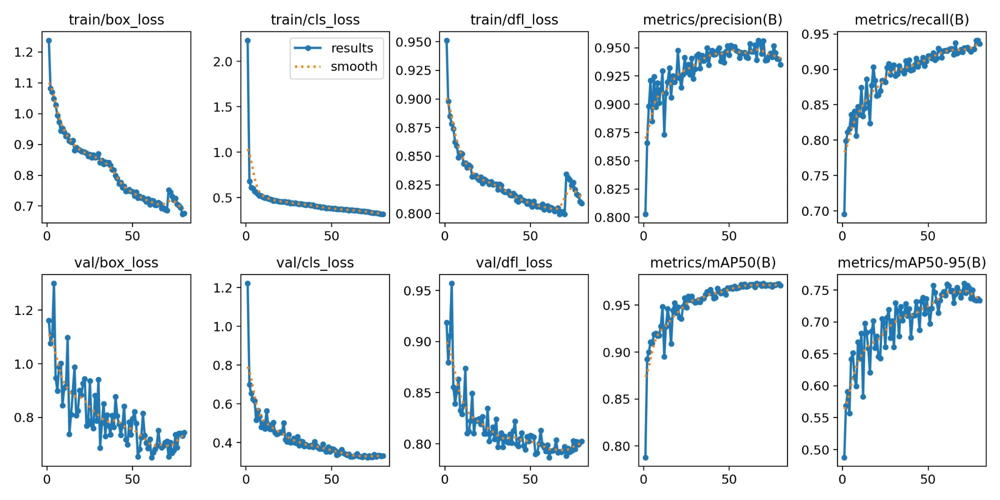
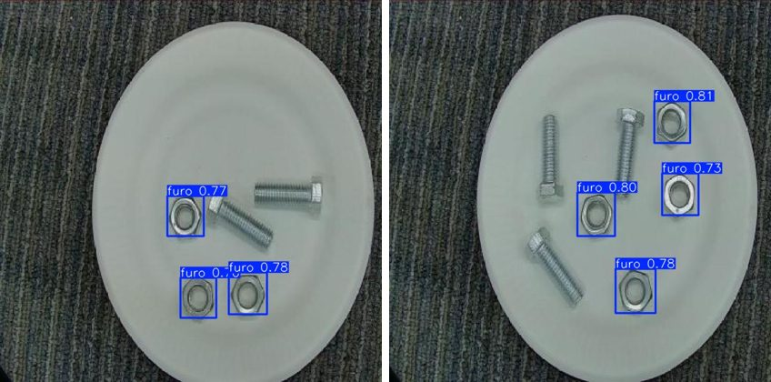

# Relatório do software – ScanParts

**Data:** 14/11/2026 · **Situação:** IA de detecção de furos treinada e testada; resto do software ainda não iniciado.

## 1. Resumo

O ScanParts quer gerar um **CAD editável** de uma peça a partir de fotos. A primeira parte de software desenvolvida
é a **IA que acha furos** nas fotos. Ela foi treinada **sem custo**, só com imagens sintéticas geradas por nós,
e chegou a **94% de precisão e 93% de recall** nas imagens sintéticas. No primeiro teste com **fotos reais**,
ela achou os furos de porcas sem nunca ter visto uma foto de verdade, mas a caixa ainda fica grande demais.

## 2. O que foi construído

| Componente | Arquivo | Situação |
|---|---|---|
| Gerador de dados sintéticos | `ia/gerar_sintetico.py` | ✅ Pronto e testado |
| Junção de datasets | `ia/juntar_datasets.py` | ✅ Pronto e testado |
| Notebook de treino (Colab) | `ia/treino_furos_colab.ipynb` | ✅ Usado no treino v2 (bug da célula 8b corrigido) |
| Modelo v1 (referência) | `ia/modelos/furos_v1.pt` | ✅ No repositório |
| Modelo v2 (melhor) | Google Drive: `scanparts_ia/treinos/furos_v1/weights/best.pt` | ✅ Treinado; falta subir para o repositório |
| Calibração da câmera, modo 2D (DXF), mesa giratória, interface web | – | ⏳ Não iniciado |

### Como a IA se encaixa no ScanParts

```
Foto da peça ──► IA (YOLO11n) acha os furos ──► Geometria mede centro e diâmetro ──► Regra interpreta
                  (caixa em volta do furo)        (dentro da caixa, em mm)              ("Ø 9,0 → passante M8")
```

A IA só **localiza**. A medida precisa vem da geometria clássica, e a interpretação vem de uma tabela de medidas padrão.

## 3. Dados

Todo o treino até agora usou **dados sintéticos**: imagens desenhadas por código, com rótulo automático.

| Item | Valor |
|---|---|
| Imagens (treino v2) | 3.000 de treino + 500 de validação |
| Furos rotulados | 15.007 |
| Imagens sem furo (exemplos negativos) | 309 |
| Custo | Zero (gerado na CPU do próprio Colab) |

O gerador simula: peças de metal e plástico em 5 formatos, furos passantes e cegos, câmera inclinada até 50°,
e coisas que **não** são furos (reflexo do ring light, sujeira, riscos, marcadores do prato).

## 4. Resultados

| Versão | Onde | Dados | Precisão | Recall | mAP50 | mAP50-95 | Tempo |
|---|---|---|---|---|---|---|---|
| v1 | CPU (4 núcleos) | 1.500 sintéticas, 416 px, 12 épocas | 0,909 | 0,828 | 0,889 | 0,475 | 25 min |
| **v2** | **Colab, GPU L4** | **3.000 sintéticas, 640 px, 80 épocas** | **0,940** | **0,928** | **0,971** | **0,760** | **26 min** |

Meta do projeto: precisão e recall **≥ 0,90**. ✅ **Atingida no sintético.**

- **Velocidade:** 1,7 ms por imagem na L4. No Jetson Orin Nano deve ficar bem abaixo da meta de 1 s por imagem (a confirmar no aparelho).
- **Tamanho do modelo:** 5,5 MB, 2,6 milhões de parâmetros.



### Teste em fotos reais (v1, dataset Mechanical Parts)

| Fotos | Detecções | Observação |
|---|---|---|
| 30 fotos reais de porcas, parafusos, rolamentos e engrenagens | 108 | Acha o furo das porcas (confiança 0,70–0,81) e ignora parafusos; caixa pega a porca inteira |



Detalhes completos de cada treino: [`resultados-ia.md`](resultados-ia.md).

## 5. Problemas encontrados e correções

| Problema | Causa | Correção |
|---|---|---|
| Borda quadrada e peça "espelhada" sem rótulo nas imagens sintéticas | Preenchimento da borda por reflexo | Fundo preenchido com textura, sem cópias da peça |
| Erro ao testar o modelo com o `.zip` | O `.zip` foi passado como se fosse uma foto | Célula que descompacta antes e acha o arquivo sozinha |
| Modelo não encontrado no Colab | `furos_v1.pt` não estava em `/content` | Modelo publicado no repositório, com download por `wget` |
| Célula 8b iniciou um treino no dataset `coco8` | "Continuar treino" rodado depois de o treino já ter terminado | A célula agora verifica se o treino terminou e não faz nada |

## 6. Limitações atuais

- As notas altas são em imagens **sintéticas**. **Ainda não existe nota em fotos reais**, porque nenhum dataset real tem os furos marcados.
- Em fotos reais, a **caixa sai maior que o furo** (pega a porca toda).
- Nenhuma foto tirada pela **câmera do projeto** (IMX219 + ring light) foi usada ainda.
- O dataset Mechanical Parts tem licença **CC BY-NC-SA 4.0** (uso não comercial).

## 7. Próximos passos

1. Subir o modelo **v2** para o repositório (`ia/modelos/furos_v2.pt`) e repetir o teste real com ele.
2. **Anotar furos** em ~100 fotos reais no CVAT, para ter a primeira nota real.
3. Treinar o **v3** com sintético + fotos reais.
4. Começar o restante do software: **calibração da câmera** e **modo 2D (foto → DXF)**.
