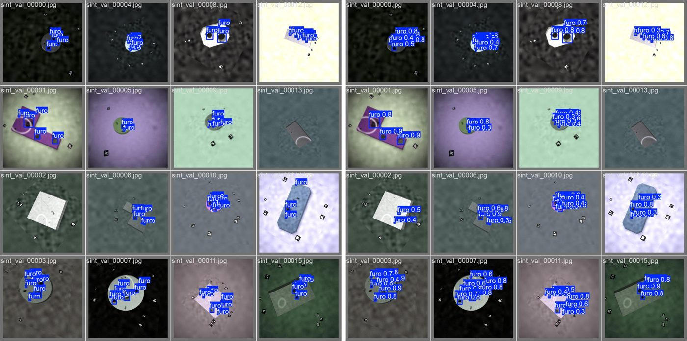
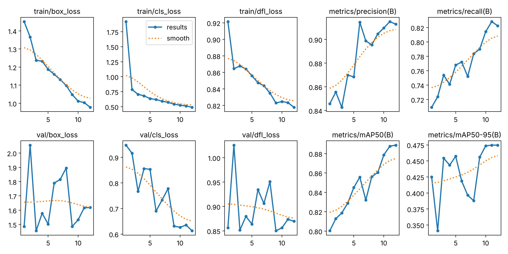
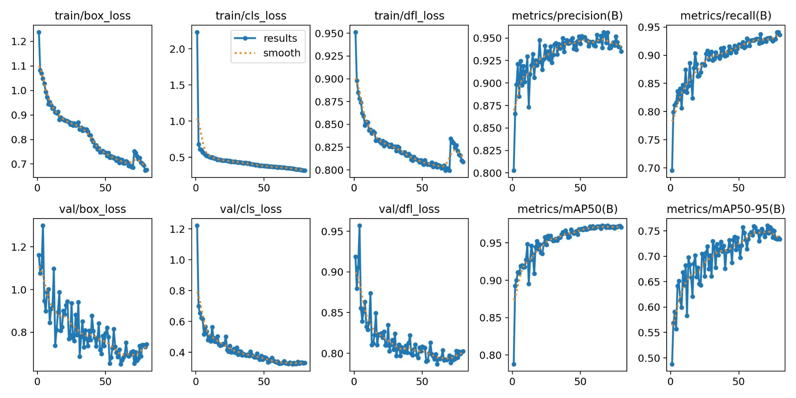
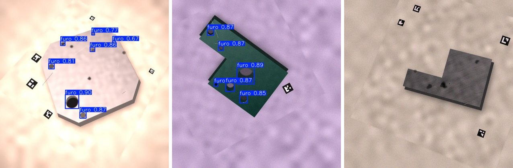
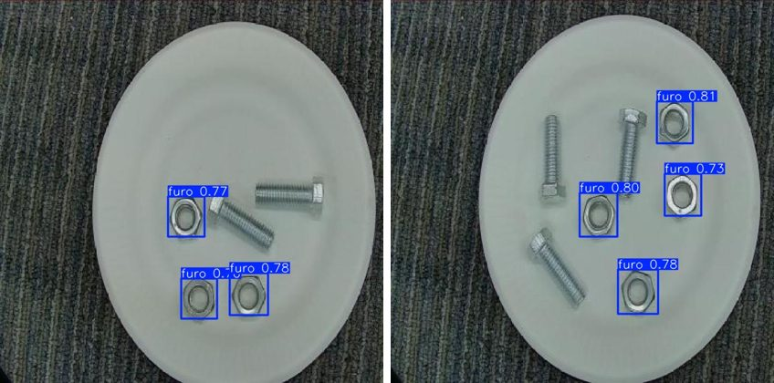

# Registro de resultados – IA de furos

Cada treino ganha uma linha na tabela e uma seção com os detalhes. Nada é apagado: os resultados ruins também ficam, porque mostram a evolução.

## Como ler as métricas

| Métrica | O que significa | Meta |
|---|---|---|
| **Precisão (P)** | Das caixas que a IA marcou, quantas eram furo de verdade | ≥ 0,90 |
| **Recall (R)** | Dos furos que existiam, quantos a IA achou | ≥ 0,90 |
| **mAP50** | Nota geral de detecção (0 a 1), aceitando caixa com ≥ 50% de sobreposição | ≥ 0,90 |
| **mAP50-95** | Nota mais exigente: também cobra caixa bem ajustada | Quanto maior, melhor |

## Resumo

| ID | Data | Dados de treino | Modelo | Img | Épocas | P | R | mAP50 | mAP50-95 | Onde |
|---|---|---|---|---|---|---|---|---|---|---|
| v1 | 14/11/2026 | Sintético 1.500 (+300 val) | YOLO11n | 416 | 12 | 0,909 | 0,828 | 0,889 | 0,475 | CPU (teste) |
| v2 | 14/11/2026 | Sintético 3.000 (+500 val) | YOLO11n | 640 | 80 | **0,940** | **0,928** | **0,971** | **0,760** | Colab, GPU L4 |

> As notas acima são em imagens **sintéticas**. O teste em fotos reais está na seção "Teste em fotos reais".

## Detalhes

### v1 – Referência só com dados sintéticos (14/11/2026)

**Objetivo:** ver se o modelo consegue aprender o conceito de furo com dados 100% sintéticos, e ter um número de partida.

**Configuração**

| Item | Valor |
|---|---|
| Dados | `gerar_sintetico.py`, semente 1: 1.500 imagens de treino (5.056 furos) + 300 de validação (1.275 furos) |
| Modelo | YOLO11n pré-treinado (COCO), detecção por caixa |
| Treino | 12 épocas, imagem de 416 px, batch 16, flips horizontal/vertical, rotação ±15° |
| Máquina | CPU, 4 núcleos (sem GPU), 25 min |

**Resultado (validação sintética)**

| Precisão | Recall | mAP50 | mAP50-95 | Inferência (CPU) |
|---|---|---|---|---|
| 0,909 | 0,828 | 0,889 | 0,475 | 16 ms/imagem |

**O que observamos**
- **Aprendeu o conceito de furo:** acerta os furos visíveis com boa confiança (0,7–0,9).
- **Ignora o reflexo do ring light:** os anéis claros não foram confundidos com furos.
- **Erra mais nos furos minúsculos:** 23% dos furos da validação têm menos de 10 px, e é aí que o recall cai.
- **Alguns falsos positivos** em manchas escuras (sujeira e marcas de centro).
- **Ainda estava melhorando** na última época: com mais épocas o número sobe.

**Limitações**
- Mede só o desempenho em imagens **sintéticas**. Não diz nada ainda sobre fotos reais.
- No gerador, a peça muitas vezes aparece **pequena** na imagem. No ScanParts real (peça de até 10 cm, câmera perto) ela ocupa boa parte da foto, e os furos ficam maiores e mais fáceis.

**Próximos passos sugeridos (v2)**
1. Gerador: aumentar o zoom para a peça ocupar mais da imagem, como no uso real.
2. Treinar no Colab (GPU T4) com 640 px, 3.000 imagens e até 80 épocas.
3. Assim que houver fotos reais, criar um **conjunto de teste real separado** e registrar a nota nele.

### v2 – Treino completo no Colab (14/11/2026)

**Objetivo:** treino completo, com mais dados e resolução cheia, na GPU do Colab.

> No Google Drive esse treino ficou salvo como `scanparts_ia/treinos/furos_v1` (nome padrão do notebook na época).
> Aqui ele é registrado como **v2**. O notebook agora usa `furos_v3` para o próximo.

**Configuração**

| Item | Valor |
|---|---|
| Dados | Sintético: 3.000 imagens de treino + 500 de validação (15.007 furos no total; 2.058 na validação; 255 + 54 imagens sem furo) |
| Modelo | YOLO11n pré-treinado (COCO), 2,6 milhões de parâmetros |
| Treino | 80 épocas, 640 px, batch 32, otimizador AdamW automático, flips e rotação ±15° |
| Máquina | Google Colab, **GPU NVIDIA L4** (22 GB), 26 min (0,427 h) |

**Resultado (validação sintética, melhor época)**

| Precisão | Recall | mAP50 | mAP50-95 | Inferência (L4) |
|---|---|---|---|---|
| 0,940 | 0,928 | 0,971 | 0,760 | 1,7 ms/imagem |

**Atingiu as metas de precisão e recall (≥ 0,90) nas imagens sintéticas.**

**O que observamos**
- **Evolução v1 → v2:** recall subiu de 0,83 para 0,93 e mAP50-95 de 0,47 para 0,76. Mais dados, mais épocas e 640 px ajudaram principalmente nos furos pequenos.
- **Sem sobreajuste:** as perdas de validação caíram junto com as de treino até o fim.
- **Platô:** o mAP50 estabiliza em ~0,97 a partir da época 50. Mais épocas no mesmo dado sintético rendem pouco; o próximo ganho tem que vir de **dados reais**.
- **Salto na época 71:** é esperado. O Ultralytics desliga o *mosaic* nas últimas 10 épocas.
- **Ignora distratores:** na peça em L só com manchas de sujeira, nenhum furo foi marcado (correto).

**Incidente:** depois do treino, a célula 8b ("continuar treino") foi rodada por engano. Como o treino já tinha
terminado, o Ultralytics iniciou um treino novo no dataset de exemplo `coco8` (classes de pessoas, animais etc.), salvo
em `/content/runs/detect/train`. **Não afetou o modelo v2.** O notebook foi corrigido: a 8b agora verifica se o treino
terminou e não faz nada nesse caso.

## Teste em fotos reais

### Teste 1 – Modelo v1 no dataset Mechanical Parts (14/11/2026)

**Objetivo:** primeira olhada em fotos **reais**, sem nenhum ajuste.

| Item | Valor |
|---|---|
| Modelo | **v1** (`ia/modelos/furos_v1.pt`, treinado só com sintético na CPU) |
| Fotos | 30 imagens aleatórias (semente 0) das 2.249 do [Mechanical Parts](https://universe.roboflow.com/mazhar-cakir/mechanical-parts) (porcas, parafusos, rolamentos, engrenagens) |
| Confiança mínima | 0,4 |
| Resultado | **108 detecções em 30 imagens** (3,6 por imagem) |

**O que observamos**
- **Generaliza para foto real:** mesmo sem nunca ter visto uma foto de verdade, o modelo achou o furo das porcas com confiança de 0,70–0,81.
- **Não marcou os parafusos**, que não têm furo visível (correto).
- **Caixa grande demais:** a caixa pega a porca inteira, não só o furo. O modelo aprendeu "região escura redonda dentro de peça", e numa porca pequena isso se confunde com a peça toda. Para a medição isso importa, porque a geometria clássica vai procurar o círculo dentro da caixa.
- **Não dá para calcular precisão e recall:** o dataset não marca os furos. Para ter número, é preciso anotar os furos dessas fotos (ou das fotos do grupo).

**Limitações:** o teste foi feito com o **v1**, não com o v2. As fotos são de celular, com outra luz e outro fundo, bem diferentes da bancada do ScanParts.

## Próximos passos

1. Rodar o **v2** nas mesmas 30 fotos do Mechanical Parts e comparar com o v1.
2. **Anotar os furos** de ~100 fotos reais (Mechanical Parts + fotos do grupo) no CVAT. Isso dá o primeiro **número real** de precisão e recall.
3. Treinar o **v3** com sintético + fotos reais anotadas.
4. Assim que a bancada estiver montada, montar um **conjunto de teste fixo** com fotos da IMX219 e do ring light.
